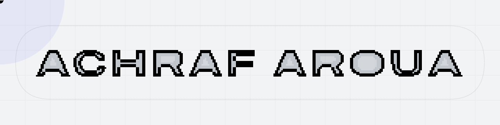

## Hi, I'm Achraf

Software engineer in Aachen. I build full-stack web apps with AI features, and I'm doing my M.Sc. in Computer Science and Systems Engineering at TH Köln.

I'm open to **working student roles and internships** in Cologne and Aachen, on site or hybrid.

[Portfolio](https://achref-2.github.io) | [LinkedIn](https://www.linkedin.com/in/achref-aroua/) | [CV (PDF)](https://achref-2.github.io/Achraf_Aroua_CV.pdf) | [arouaachref8@gmail.com](mailto:arouaachref8@gmail.com)

### Projects

| Project | What it does | Built with |
| --- | --- | --- |
| [TalentSync](https://github.com/achref-2/TalentSync-App) | Recruitment platform that compares a CV with a job description and returns a match score, feedback and a draft cover letter. My final-year project, graded Excellent. [Live preview](https://achref-2.github.io/TalentSync-App/) | React, Node.js, Express, MongoDB, Python, Gemini API |
| [GhostMate](https://github.com/achref-2/Agent) | Personal AI assistant for student life. The model can only act through 16 typed tools, every tool call is shown, and deleting needs a click. Answers about lecture PDFs cite the page. | React 19, TypeScript, Express 5, MongoDB, Zod, Claude API |
| [Map → Plan → Drive](https://github.com/achref-2/ams-map-plan-drive) | A TurtleBot3 explores a building it has never seen and maps it on its own. Team project at TH Köln. | ROS 2, Gazebo, Nav2, slam_toolbox, Python |
| [Portfolio](https://github.com/achref-2/achref-2.github.io) | My website. The robot at the top maps my name in your browser, using frontier exploration and A*. | HTML, CSS, JavaScript |

### Right now

- Learning retrieval-augmented generation by building a small RAG system from scratch
- Building our own frontier explorer for the TH Köln robotics project

### Tools I use

Java, Python, JavaScript, TypeScript, PHP, ABAP 
React, Next.js, Vue.js, Tailwind CSS, Node.js, Express, Spring Boot 
MongoDB, PostgreSQL, MySQL, Redis 
Docker, Kubernetes, AWS, Git, ROS 2

German (C1), English, French and Arabic.
